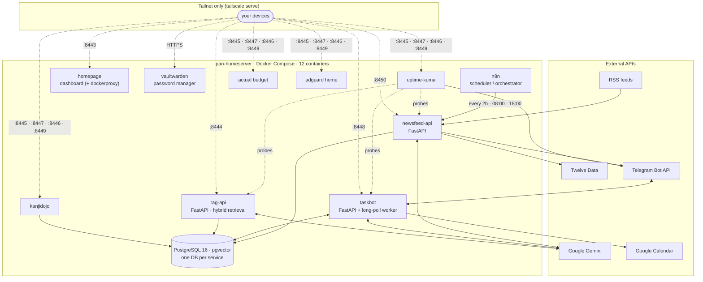
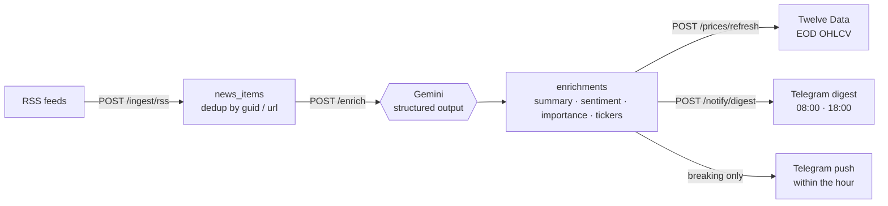
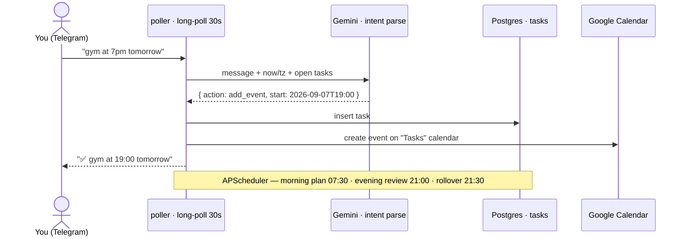
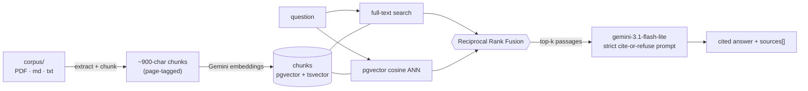

<div align="center">

# 🏠 pan-homeserver

**A 12-container self-hosted platform on a 2013 mini PC.**

Three custom-built application services — an AI news-digest pipeline, a
conversational Telegram task manager, and a RAG study-Q&A bot — running
alongside a password vault, uptime monitoring, budgeting, and DNS filtering,
all behind a single dashboard, orchestrated by n8n, backed by one Postgres
(with `pgvector`), shipped with Docker Compose, administered entirely over
SSH with zero ports exposed to the public internet.


</div>

---

## What's in the box

**Custom-built** (this repo's own FastAPI services — see the sections below):

| Service | What it does |
|---|---|
| **[`newsfeed-api`](n8n-stack/newsfeed-api/)** | RSS → Postgres → LLM (factual summary + tickers/tags) → EOD prices → Telegram digest, plus a searchable/filterable web reader; Tailscale `:8450` |
| **[`taskbot`](n8n-stack/taskbot/)** | Plain-language Telegram bot + web app → managed task list + opt-in Google Calendar sync + daily plan/review; Tailscale `:8448` |
| **[`rag-api`](n8n-stack/rag-api/)** | Ask questions about your own PDFs/notes; hybrid retrieval (pgvector + full-text + RRF) + cited answers; Tailscale `:8444` |

**Deployed & operated** (off-the-shelf images, wired into the same
compose/backup/Tailscale/dashboard setup):

| Service | What it does |
|---|---|
| `vaultwarden` | Bitwarden-compatible password manager — Tailscale `:443` |
| `homepage` | Dashboard — every service, live container status, system resources; `+ dockerproxy`, a read-only Docker-socket filter — Tailscale `:8443` |
| `uptime-kuma` | Uptime monitoring for every service's health endpoint, Telegram alerts on failure — Tailscale `:8445` |
| `actual` | Actual Budget — self-hosted envelope budgeting — Tailscale `:8447` |
| `adguard` | AdGuard Home — DNS ad/tracker blocking, opt-in per tailnet device — Tailscale `:8446` |
| `kanjidojo` | Kanji/kana SRS study app — the user's own separate [`learn-kanji`](https://github.com/panmanzee/learn-kanji) repo, built as a sibling checkout — Tailscale `:8449` |
| `n8n` | Cron orchestrator — calls `newsfeed-api` on a schedule |
| `postgres` | One instance, one database per service (`pgvector`-enabled) |

Everything is reached over **Tailscale only**, via `tailscale serve` — one
port per service, TLS terminated by Tailscale, nothing bound to the LAN or the
public internet, no Funnel.

Nightly `scripts/backup.sh` (cron, 03:00) dumps every Postgres database plus
every service's data volume into one timestamped `~/backups/*.tar.gz`, keeping
the last 14 — with an optional off-box copy to Backblaze B2 via `rclone`
(skips cleanly if not configured).

> **SSH-only.** No monitor, keyboard, or IPMI on this box. Every change lands
> through version control and `docker compose` — nothing is hand-edited on the
> server.

---

## 🗺️ Architecture



---

## 📰 newsfeed-api — AI news & markets digest

RSS articles in, a compact twice-daily Telegram digest out. The LLM **only
condenses** information — it never predicts prices or gives buy/sell advice.



- **Pluggable LLM** — Gemini free tier by default (~\$0/month), Claude Haiku optional. Same JSON shape either way, same pydantic validation.
- **Cost + freshness bounded** — articles older than 48 h that were never enriched are dropped (marked sent, no LLM call).
- **Idempotent** — every stage is safe to re-run: `ON CONFLICT DO NOTHING` on ingest, a `tg_notified_at` mark guards against double-sends.
- **Data model** — `feeds`, `news_items`, `enrichments`, `tickers`, `stock_prices`, and a `v_news_enriched` view.

**Web reader** (`GET /`, Tailscale `:8450`) — Telegram is good for a nudge,
bad for browsing history, so the archive of enriched articles (7k+ and
growing) is also a searchable, filterable single-page app: free-text search
over titles/tags, quick filters for category/importance/sentiment/ticker,
importance-colored rows so `breaking` visibly outranks `routine`, grouped by
day, "Load more" paging. `GET /api/articles` + `GET /api/facets` back it —
public within the tailnet, unauthenticated (same trust model as `rag-api`);
the pipeline's internal endpoints (`/ingest/rss`, `/enrich`, `/notify/*`)
keep their `X-API-Key` gate, untouched. Design:
[`docs/superpowers/specs/2026-09-17-newsfeed-web-frontend-design.md`](n8n-stack/docs/superpowers/specs/2026-09-17-newsfeed-web-frontend-design.md).

**Today's Picks** — a second tab on the same page: a tech-first (also
healthcare + other) daily stock screener. Deliberately **not** an LLM
recommendation — `enrich.py`'s prompt has a standing rule against price
predictions or buy/sell advice, so this reuses that same principle: every
pick is a transparent, auditable combination of two signals already in
Postgres (`stock_prices` momentum + `news_tickers`/`enrichments` attention
and sentiment), with a visible formula and one honest disclaimer line — not
an opinion. A ticker only appears if its price rose **and** its recent news
is net-positive. `GET /api/picks`. Design:
[`docs/superpowers/specs/2026-09-21-todays-picks-design.md`](n8n-stack/docs/superpowers/specs/2026-09-21-todays-picks-design.md).

📄 Full docs: **[`n8n-stack/README.md`](n8n-stack/README.md)**

---

## ✅ taskbot — conversational task & schedule manager

Text plain sentences to a Telegram bot. No slash commands — an LLM turns each
message into one typed action.



| You type | The bot does |
|---|---|
| `math homework today` | adds an untimed task for the day |
| `gym at 11pm` | adds a timed task + a calendar event |
| `done with the homework` | marks it complete, renames the calendar event `✓ …` |
| `move gym to 9pm` · `delete the call` | reschedules / cancels, patches the calendar |
| `what's today` | lists that day's tasks and timed items |

- **Degrades gracefully** — no Google config → the calendar mirror is a silent no-op; an LLM error → a polite "try again" reply; the poll loop never crashes on bad input.
- **Exactly-once polling** — the `getUpdates` offset lives in Postgres, so a restart never drops or replays a message.
- **Single-user** — only ever responds to one allow-listed Telegram chat id.

📄 Full docs + Google Calendar setup: **[`n8n-stack/taskbot/README.md`](n8n-stack/taskbot/README.md)**

---

## 🔎 rag-api — study Q&A over your own PDFs

Ask plain-language questions about your own study material (CCNA guides, notes)
and get a short answer that cites the passages it used — drawn only from the
retrieved chunks, never the model's general knowledge. If the material doesn't
cover something, the answer says so and returns no sources. A single
self-contained HTML page at `/`, reachable from the tailnet at `:8444`.



Ingestion is idempotent (SHA-256 hash-skip) and isolates per-file failures.
Drop files in `corpus/` (bind-mounted read-only, gitignored) then
`curl -XPOST .../ingest -H "X-API-Key: $KEY" -d '{}'`.

📄 Full docs: **[`n8n-stack/rag-api/README.md`](n8n-stack/rag-api/README.md)**

---

## 🧩 Other self-hosted services

Off-the-shelf apps, wired into the same Docker Compose stack, Postgres,
Tailscale `serve` map, dashboard, and nightly backup as the custom services
above:

- **Vaultwarden** — Bitwarden-compatible vault; bound to `127.0.0.1` only, the
  `/admin` panel disabled, reached solely through `tailscale serve` HTTPS.
- **Uptime Kuma** — polls every service's health endpoint and pushes a
  Telegram alert on failure.
- **Actual Budget** — self-hosted envelope budgeting (SQLite-backed, chosen
  over Firefly III for a lighter footprint on this hardware).
- **AdGuard Home** — DNS ad/tracker blocking. The DNS listener is bound
  **only** to the Tailscale interface IP, never the LAN or the router — a
  deliberate safety boundary so it can never take down name resolution for
  the box itself. Opt-in per device.
- **KanjiDojo** — a separate personal project
  ([`panmanzee/learn-kanji`](https://github.com/panmanzee/learn-kanji), its
  own FastAPI + vanilla-JS app) deployed here as a sibling checkout — the
  reusable pattern for running any of my own repos on this box at zero
  extra infrastructure cost: its own Postgres database, no new container
  image to maintain, covered by the same backup script automatically.

---

## 🧰 Tech stack

| Layer | Choice |
|---|---|
| Runtime | Python 3.12 · FastAPI · Uvicorn |
| Data | PostgreSQL 16 + `pgvector` · `psycopg` 3 + connection pool · schema applied on boot |
| Retrieval | Hybrid search — `pgvector` cosine ANN + Postgres full-text (`tsvector`) fused with Reciprocal Rank Fusion (`rag-api`) |
| Documents | PyMuPDF (PDF text + page numbers) · character-window chunker with overlap |
| LLM | Google Gemini (default) / Anthropic Claude (optional) — structured output & tool-use; `gemini-embedding-001` for RAG embeddings |
| Integrations | Telegram Bot API · Google Calendar API · Twelve Data |
| Scheduling | n8n cron workflows (cross-service) · APScheduler (in-process jobs) |
| Networking | Tailscale mesh VPN — `tailscale serve` per-port HTTPS, zero inbound ports on the router, no Funnel |
| Delivery | Docker Compose · multi-stage `python:3.12-slim` images · read-only Docker-socket proxy for the dashboard |
| Backups | Nightly `pg_dumpall` + volume tar, 14-day local retention, optional off-box copy via `rclone` (Backblaze B2) |
| Tests | pytest — every external (HTTP, LLM, DB) mocked; `respx` for request-level assertions — **159 tests** across the 3 custom services |

---

## 📁 Repo layout

```
.
├── n8n-stack/
│   ├── docker-compose.yml          # all 12 services
│   ├── .env.example                # every knob, documented
│   ├── newsfeed-api/               # FastAPI: RSS · LLM enrichment · prices · Telegram
│   ├── taskbot/                    # FastAPI + long-poll worker: tasks · calendar
│   ├── rag-api/                    # FastAPI: PDF/notes ingest · hybrid retrieval · cited answers
│   ├── homepage/config/            # dashboard tile config (tracked in git)
│   ├── scripts/backup.sh           # nightly pg_dumpall + volume tar (+ optional rclone off-box copy)
│   └── n8n/workflows/              # exported n8n cron workflows
└── docs/
    ├── portfolio-roadmap.md
    └── superpowers/{specs,plans}/  # brainstorm → spec → plan, one set per service
```

The off-the-shelf services (Vaultwarden, Uptime Kuma, Actual, AdGuard) ship no
custom code, so they're config-only in this repo (compose block + `.env` +
dashboard tile); KanjiDojo lives in its own sibling repo entirely, built via
`build: ../../learn-kanji`.

---

## 🚀 Running it

```bash
cd n8n-stack
cp .env.example .env          # fill in POSTGRES_PASSWORD, SERVICE_API_KEY, GEMINI_API_KEY, TELEGRAM_*
docker compose up -d          # brings up all 12 services
```

Each service creates its own database and applies its own schema on first boot.
Per-service bootstrap (n8n workflow import, feed seeds, Telegram chat id,
first-run setup wizards for Uptime Kuma/Actual/AdGuard) is in the linked
READMEs.

## 🧪 Development

```bash
cd n8n-stack/taskbot          # or newsfeed-api / rag-api
python -m venv .venv && .venv/bin/pip install -r requirements-dev.txt
.venv/bin/python -m pytest -q
```

---

## 📌 About

Personal infrastructure, built as a portfolio piece and run for real — 12
containers, 3 of them custom FastAPI services backed by 159 passing tests, the
rest deployed and operated off-the-shelf apps, all reachable only over a
Tailscale mesh VPN with nothing exposed to the public internet. The design
docs under [`docs/superpowers/`](docs/superpowers/) capture the full
brainstorm → spec → plan → build cycle behind each custom service. Idle
footprint is ~1.3 GB across the whole stack — the 2013 low-power chip handles
it comfortably.
