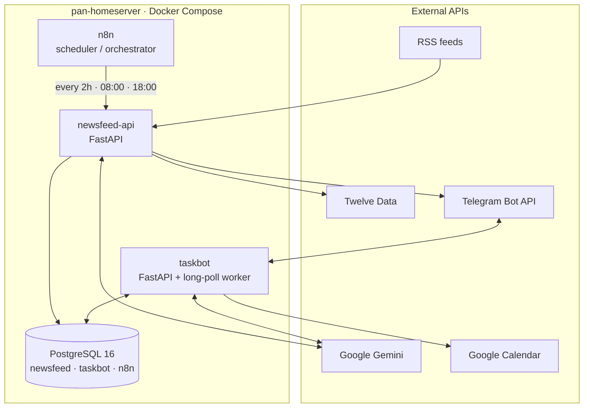
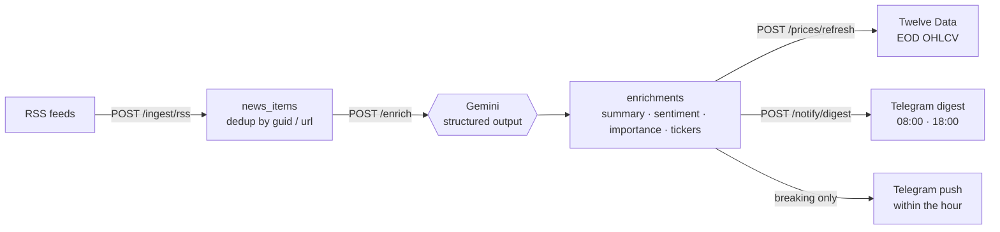
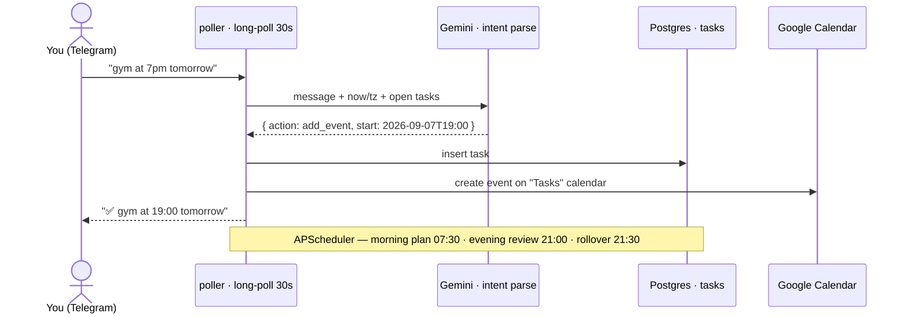

<div align="center">

# 🏠 pan-homeserver

**A self-hosted automation stack on a 2013 mini PC.**

Two production services on one Intel i5-4570T box — an AI news-digest pipeline
and a conversational Telegram task manager — orchestrated by n8n, backed by a
single Postgres, shipped with Docker Compose, administered entirely over SSH.


</div>

---

## What's in the box

| Service | What it does |
|---|---|
| **[`newsfeed-api`](n8n-stack/newsfeed-api/)** | RSS → Postgres → LLM (factual summary + tickers/tags) → EOD prices → Telegram digest |
| **[`taskbot`](n8n-stack/taskbot/)** | Plain-language Telegram bot → managed task list + Google Calendar mirror + daily plan/review |
| `vaultwarden` | Self-hosted Bitwarden-compatible password manager, reachable only over Tailscale (HTTPS via `tailscale serve`) |
| `homepage` | Dashboard — every service, live container status, system resources; behind Tailscale (`+ dockerproxy`, a read-only Docker-socket filter) |
| `n8n` | Cron orchestrator — calls `newsfeed-api` on a schedule |
| `postgres` | One instance, one database per service (`newsfeed`, `taskbot`, `n8n`) |

Reached over Tailscale only: the dashboard at `https://<host>.ts.net:8443/`, the
vault at `https://<host>.ts.net/`. Nothing is exposed to the LAN or the internet
via `tailscale serve` — no Funnel.

Nightly `scripts/backup.sh` (cron, 03:00) dumps every Postgres database plus the
`n8n` and `vaultwarden` data volumes into one timestamped `~/backups/*.tar.gz`,
keeping the last 14.

> **SSH-only.** No monitor, keyboard, or IPMI on this box. Every change lands
> through version control and `docker compose` — nothing is hand-edited on the
> server.

---

## 🗺️ Architecture



---

## 📰 newsfeed-api — AI news & markets digest

RSS articles in, a compact twice-daily Telegram digest out. The LLM **only
condenses** information — it never predicts prices or gives buy/sell advice.



- **Pluggable LLM** — Gemini free tier by default (~\$0/month), Claude Haiku optional. Same JSON shape either way, same pydantic validation.
- **Cost + freshness bounded** — articles older than 48 h that were never enriched are dropped (marked sent, no LLM call).
- **Idempotent** — every stage is safe to re-run: `ON CONFLICT DO NOTHING` on ingest, a `tg_notified_at` mark guards against double-sends.
- **Data model** — `feeds`, `news_items`, `enrichments`, `tickers`, `stock_prices`, and a `v_news_enriched` view.

📄 Full docs: **[`n8n-stack/README.md`](n8n-stack/README.md)**

---

## ✅ taskbot — conversational task & schedule manager

Text plain sentences to a Telegram bot. No slash commands — an LLM turns each
message into one typed action.



| You type | The bot does |
|---|---|
| `math homework today` | adds an untimed task for the day |
| `gym at 11pm` | adds a timed task + a calendar event |
| `done with the homework` | marks it complete, renames the calendar event `✓ …` |
| `move gym to 9pm` · `delete the call` | reschedules / cancels, patches the calendar |
| `what's today` | lists that day's tasks and timed items |

- **Degrades gracefully** — no Google config → the calendar mirror is a silent no-op; an LLM error → a polite "try again" reply; the poll loop never crashes on bad input.
- **Exactly-once polling** — the `getUpdates` offset lives in Postgres, so a restart never drops or replays a message.
- **Single-user** — only ever responds to one allow-listed Telegram chat id.

📄 Full docs + Google Calendar setup: **[`n8n-stack/taskbot/README.md`](n8n-stack/taskbot/README.md)**

---

## 🧰 Tech stack

| Layer | Choice |
|---|---|
| Runtime | Python 3.12 · FastAPI · Uvicorn |
| Data | PostgreSQL 16 · `psycopg` 3 + connection pool · schema applied on boot |
| LLM | Google Gemini (default) / Anthropic Claude (optional) — structured output & tool-use |
| Integrations | Telegram Bot API · Google Calendar API · Twelve Data |
| Scheduling | n8n cron workflows (cross-service) · APScheduler (in-process jobs) |
| Delivery | Docker Compose · multi-stage `python:3.12-slim` images |
| Tests | pytest — every external (HTTP, LLM, DB) mocked; `respx` for request-level assertions |

---

## 📁 Repo layout

```
.
├── n8n-stack/
│   ├── docker-compose.yml          # postgres · n8n · newsfeed-api · taskbot
│   ├── .env.example                # every knob, documented
│   ├── newsfeed-api/               # FastAPI: RSS · LLM enrichment · prices · Telegram
│   ├── taskbot/                    # FastAPI + long-poll worker: tasks · calendar
│   └── n8n/workflows/              # exported n8n cron workflows
└── docs/
    ├── portfolio-roadmap.md
    └── superpowers/{specs,plans}/  # brainstorm → spec → plan, one set per service
```

---

## 🚀 Running it

```bash
cd n8n-stack
cp .env.example .env          # fill in POSTGRES_PASSWORD, SERVICE_API_KEY, GEMINI_API_KEY, TELEGRAM_*
docker compose up -d          # postgres · n8n · newsfeed-api · taskbot
```

Each service creates its own database and applies its own schema on first boot.
Per-service bootstrap (n8n workflow import, feed seeds, Telegram chat id) is in
the linked READMEs.

## 🧪 Development

```bash
cd n8n-stack/taskbot          # or newsfeed-api
python -m venv .venv && .venv/bin/pip install -r requirements-dev.txt
.venv/bin/python -m pytest -q
```

---

## 📌 About

Personal infrastructure, built as a portfolio piece and run for real. The design
docs under [`docs/superpowers/`](docs/superpowers/) capture the full
brainstorm → spec → plan → build cycle behind each service. Idle footprint is
~0.7 GB — the 2013 low-power chip handles the whole stack comfortably.
