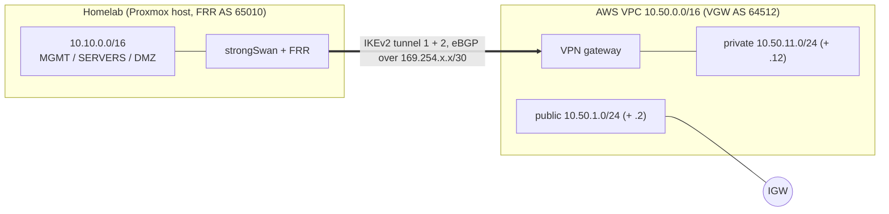

# AWS DR site over Site-to-Site VPN (design step 1.7)

Off-site recovery path for the homelab: a small VPC reached over two IPsec tunnels with BGP
from the Proxmox host. **No AWS account was used.** Nothing here has run on real AWS.



The home router is behind ISP NAT with a changing public IP, so `customer_gateway_ip` is a
variable to update before each `apply`.

## Layout

- `terraform/` - VPC, subnets, IGW, route tables, optional NAT (`enable_nat`, default false),
  SG + private-subnet NACL, VGW / customer gateway / VPN connection (BGP), route propagation,
  optional DR instance (`enable_dr_instance`, default false), 5 USD budget, `use_localstack` switch.
- `homelab-side/` - strongSwan `swanctl.conf` + FRR `frr.conf` templates and `render.py`,
  which fills them from `terraform output -json`.
- `sim/` - container simulation of the tunnel + BGP.
- `run-checks.sh` - fmt / init / validate / plan / apply / destroy against LocalStack (port 4567).
- `results/` - logs from the lab PC.

## What was actually done

| | status | evidence |
|---|---|---|
| `terraform fmt -check`, `init`, `validate` | OK (TF 1.9.8, aws provider 5.100) | `results/terraform-*.log` |
| `plan` with `use_localstack=true` | OK, 24 to add | same log |
| `apply` on LocalStack 3.8 | partial, see below | same log |
| `destroy` on LocalStack | OK | same log |
| strongSwan + FRR tunnel and BGP | **SIMULATED** (two containers) | `results/vpn-sim-*.log` |
| real AWS (VGW, real tunnels, budget, DR instance) | **not run**, needs Pan's account | - |

### LocalStack apply
Full apply (24 resources): 22 created, 2 refused with HTTP 501:
- `aws_budgets_budget` - the budgets API is not implemented in LocalStack community.
- `aws_vpn_gateway_route_propagation` - `EnableVgwRoutePropagation` not implemented.

VPC, subnets, IGW, route tables, SG, NACL + rules, VGW, customer gateway and **the VPN connection**
were created. Second apply with `-var create_budget=false -var create_route_propagation=false`:
22 added, 0 errors, destroy clean. The LocalStack VPN connection is a stub: both tunnels came back with
the same outside and inside addresses, so `render.py` output from it only proves the plumbing,
the real tunnel values come from AWS. The DR instance was not applied (needs an AMI lookup, off by default).

The NACL, SG and the BGP policy (prefix-lists) are only reviewed, not tested against traffic.

### Simulation
`sim/test.sh` builds one Debian image (strongSwan + FRR), starts `home` (AS 65010, config rendered
from the real templates) and `aws` (AS 64512, stand-in for the VGW), brings up one IKEv2 tunnel,
and checks: BGP Established, `10.10.0.0/16` and `10.50.0.0/16` learned on the right side, ping
between `10.10.10.1` and `10.50.11.1` with the ESP packet counters going up.
Limits: one tunnel only, VTI instead of XFRM interface (the WSL2 kernel on the PC has no
`CONFIG_XFRM_INTERFACE`; `render.py --mode vti`), both ends are strongSwan, not the real AWS VGW.
Default `render.py` mode is `xfrm`, untested here.

## Using it (when there is an account)

```
cd terraform
cp terraform.tfvars.example terraform.tfvars   # set customer_gateway_ip, budget_email
terraform init && terraform plan && terraform apply
terraform output -json > ../homelab-side/tf-output.json
cd ../homelab-side && ./render.py tf-output.json --local-id <home public ip>
# copy out/ to the Proxmox host: setup-xfrm.sh, swanctl.conf -> /etc/swanctl/conf.d/,
# strongswan-routes.conf -> /etc/strongswan.d/, frr.conf (enable bgpd + staticd)
terraform destroy   # when done
```

Rendered files in `homelab-side/out/` contain PSKs and are git-ignored.
`charon.install_routes = no` is set so charon does not install routes for the 0.0.0.0/0 selectors
(it would add a default route in table 220). Routes come from BGP instead.

## Cost
Site-to-Site VPN is about 0.05 USD per hour per connection (about 36 USD a month if left on), plus data.
NAT gateway is off by default for the same reason. Tear down after tests. The 5 USD budget only alerts
at 80 percent of actual spend, it does not stop anything.
