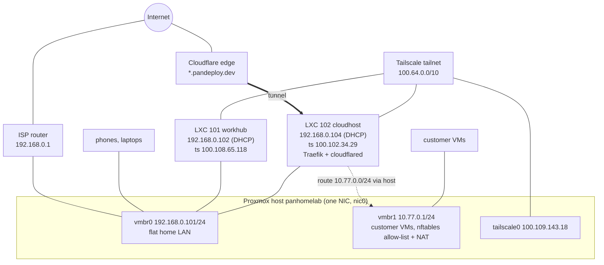
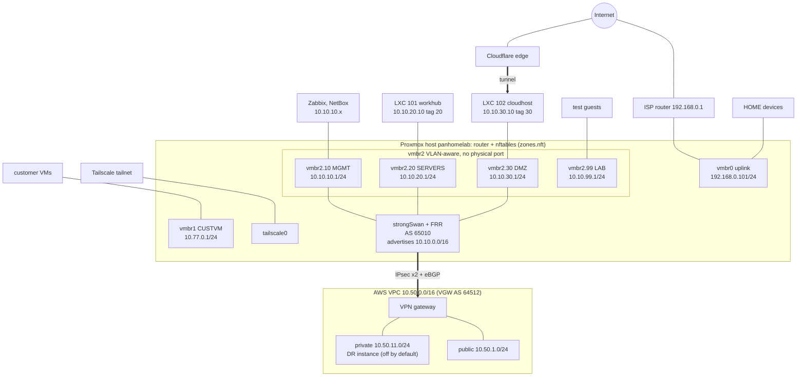

# Topology

Two views of the same box: what runs today, and what the zone plan in `zones.md` turns it into.
Sources: `../discovery/raw/*.txt` (2026-11-21), `zones.md`, `../aws/`.

## Current

One Proxmox host with one NIC. Home devices, the host and both LXCs share `vmbr0`.
Only customer VMs sit on their own bridge (`vmbr1`).

Notes
- LXC 101 and 102 take their address by DHCP, so it can change (see `incidents/2026-11-dhcp-lease-swap.md`).
- Tailscale runs on the host and inside both LXCs. Traefik (`coolify-proxy`, listed in `../discovery/raw/ct102-docker.txt`) and the Cloudflare tunnel connector (cloudflared) in cloudhost serve *.pandeploy.dev. That the tunnel feeds Traefik comes from my vault map (`Homelab/MAP.md`, lines 72, 80 and 124), not from the discovery dump. Port 127.0.0.1:20241 is listening in both guests (`../discovery/raw/ct101.txt`, `ct102.txt`); calling it the cloudflared metrics port is from `Homelab/MAP.md` line 80.
- vmbr1 traffic is limited by the `cloudhost_vm` nftables tables on the host (`../discovery/raw/host-nft.txt`).

## Target

Same host, same single NIC. `vmbr2` is a VLAN-aware bridge with no physical port, the host is the router
between zones and nftables (`../zones/nftables/zones.nft`) is the firewall. The home LAN and ISP router are not changed.
The AWS side is a VPC reached by site-to-site VPN with BGP (`../aws/`). The tunnel and BGP were only
simulated in containers, nothing ran on real AWS.

Notes
- Zone names, subnets and the allow/deny matrix are in `zones.md`. Addresses are in `ip-plan.md`.
- VLAN 50 (CUSTVM) stays untagged on `vmbr1` for now.
- MGMT has no guests yet. Zabbix and NetBox are drawn there as the plan; today Zabbix runs on workhub.
- BGP advertises 10.10.0.0/16 (all zones), AWS advertises 10.50.0.0/16 (`../aws/homelab-side/frr.conf.tpl`).

## PNG

The diagram sources are `img/current.mmd` and `img/target.mmd`. PNG export was tried with
`@mermaid-js/mermaid-cli` on the lab PC and failed: headless Chrome there is missing `libnspr4.so`.
GitHub renders the Mermaid blocks above directly. To make PNGs later: install the Chrome libs on the PC, then
`npx -y @mermaid-js/mermaid-cli -i docs/img/target.mmd -o docs/img/target.png`.
